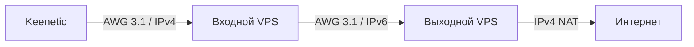

# AWG Chain Installer

**Графический установщик двухузлового VPN на Go и Fyne.**

Вместо десятков SSH-команд — одно окно: введите IPv4, SSH-порты, логины и пароли двух VPS, выберите папку и нажмите «Запустить установку». Программа подготовит нативный AmneziaWG 3.1, настроит маршруты, проверит выход и сохранит клиентский конфигурационный файл для импорта в Keenetic.

## Схема



Маршрутизация доменов остаётся на Keenetic. На входном VPS PBR передаёт только домашний VPN-трафик через второй туннель; собственный SSH и трафик VPS идут напрямую. Внутри IPv6-транспорта между серверами передаются IPv4-пакеты.

## Режимы и совместимость с Amnezia VPN

**Standalone**: штатный режим развёртывания на **двух чистых VPS**, создаёт нативные интерфейсы `awg-client` (устройства), `awg-mediator` (межсерверный туннель), `awg-destination` (выходной сервер). Географическое местоположение серверов значения не имеет.

**Amnezia VPN (эксперимент)**: отдельная вкладка выполняет **только чтение** состояния промежуточного VPS по SSH. Она распознаёт нативные интерфейсы (`awg-client`, `awg-mediator` и старые `awg-home`, `awg-fin`) и официальные Docker-контейнеры (`amnezia-awg2`, `amnezia-awg`). Этот режим **пока не устанавливает контейнеры, не меняет сетевые правила и не создаёт пользователей**. Он нужен, чтобы безопасно определить архитектуру существующего сервера перед интеграцией.

Официальное приложение Amnezia VPN способно находить уже развёрнутые **Amnezia-managed** сервисы: *Self-hosted → Пропустить установку → Управление → Проверить сервер на ранее установленные сервисы*. Нативные интерфейсы AWG не являются такими сервисами и не становятся управляемыми просто после установки Docker. Подробнее: [официальная документация](https://docs.amnezia.org/documentation/instructions/check-server/).

Полноценная автоматическая установка **Managed by Amnezia** требует отдельной проверки маршрутизации Docker-контейнера через промежуточный туннель на чистых тестовых VPS. До её завершения этот режим не следует использовать как замену Standalone.

## Использование

1. Подготовьте два чистых VPS с Ubuntu Server 24.04 LTS x86_64, GA-ядром 6.8, публичными IPv4 и IPv6, входом по SSH под root и без конфликтующих VPN.
2. Скачайте исполняемый файл для своей ОС из **Releases** (после публикации первого успешного релиза) или соберите проект из исходников.
3. Запустите приложение, введите IP/SSH-данные обоих серверов и выберите папку для результата.
4. При первом подключении **сверьте SSH SHA256 fingerprint** с данными хостинга и подтвердите его.
5. Дождитесь проверки туннеля и выходного IPv4. Заберите файл профиля из выбранной папки.
6. Импортируйте файл в KeeneticOS с поддержкой AmneziaWG 3.1 и назначьте подключение существующей политике маршрутизации.

**Никакие реальные SSH-пароли или приватные ключи не должны добавляться в GitHub или прикладываться к issue.** Пароли используются только при подключении; клиентский конфиг содержит секреты, поэтому храните его безопасно.

## Сборка из исходников

Нужен Go 1.26+, компилятор C и зависимости Fyne (OpenGL/GLFW). На Windows сборка требует MinGW-w64. Для Ubuntu нужны xorg-dev, libgl1-mesa-dev, libwayland-dev, wayland-protocols и libxkbcommon-dev.

```bash
go mod tidy
go test ./internal/...
go run ./cmd/awg-chain
```

Windows (MSYS2 MINGW64):

```bash
CGO_ENABLED=1 go build -ldflags='-H windowsgui' -o AWG-Chain-Installer.exe ./cmd/awg-chain
```

Автоматические сборки для Windows, Linux и macOS находятся в разделе [Actions](../../actions). При публикации тега вида v0.1.0 workflow загрузит бинарники в GitHub Releases. **Способ установки из исходников проверен на двух тестовых VPS. Графическая сборка после переноса требует отдельной проверки.**

## Принципы надёжности

Установщик сначала проводит **preflight**: проверяет Ubuntu, архитектуру, ядро, публичный IPv6, внешние интерфейсы, firewall, свободные UDP-порты и отсутствие конфликтов PBR. Если на VPS уже работает чужая конфигурация AWG, программа остановится, а не перезапишет её. Вход SSH не изменяется.

AmneziaWG 3.1.20260812 устанавливается путём сборки официальных исходников из двух GitHub-репозиториев Amnezia (зафиксированные commit SHA): модуль ядра устанавливается через DKMS, утилиты `awg` / `awg-quick` — через `make install`. Пакеты сборочных зависимостей загружаются из подписанных репозиториев Ubuntu. **Исходники GitHub не являются GPG-подписанными `.deb`-пакетами**: TLS и закреплённые SHA защищают от случайного изменения версии, но не равнозначны проверке GPG-подписи выпуска. При первом запуске на чистых VPS нужна доступность GitHub и зеркал Ubuntu. Метод проверен на двух Ubuntu 24.04 VPS: цепочка и внешний IPv4 успешно проверены за 1 минуту 50 секунд.

Проверяются handshake, доступность IPv4 внутри IPv6-туннеля, конечный IPv4 выхода, kill switch/PBR, NAT и обратный маршрут. Автозапуск выполняется через systemd. Защита от утечек блокирует обход выходного туннеля, но не заменяет отдельную настройку IPv6-политик Keenetic.

## Текущие ограничения

Это **первая версия для чистых VPS**; режим обновления существующей инфраструктуры, произвольные подсети/порты, SSH-ключи и полный откат ещё не реализованы. Программа **может оставить частично выполненные изменения**, если установка оборвётся на середине. Для сложных firewall и облачных панелей нужны отдельные проверки. Подробнее — [безопасность и ограничения](docs/SECURITY.md).

Проект не аффилирован с Amnezia и Keenetic.
