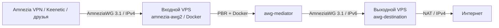

# AWG Chain Installer

Графический установщик двухузлового VPN на Go + Fyne. **Режим v0.3.1 по умолчанию: официальный Amnezia-managed Docker на входном сервере**, межсерверный нативный AWG 3.1, выход через второй VPS.



Программа **не создаёт собственную базу пользователей и не выдаёт клиентские конфигурации**. Официальное приложение Amnezia VPN находит установленный сервис, создаёт пользователей, импортирует и экспортирует конфигурации для клиентов и роутеров.

## Установка с нуля

Поддерживаются **две чистые Ubuntu Server 24.04 LTS x86_64**, штатное ядро Linux 6.8, публичные IPv4/IPv6, SSH под root. Откройте входной UDP 55424 и выходной UDP 51820 в облачной панели / внешнем firewall. Программа проверит сети и наличие конфликтующих конфигураций и остановится, если обнаружит действующий VPN. Никакого изменения SSH-авторизации.

1. Запустите сборку GUI со страницы [GitHub Actions](../../actions) или соберите из исходников.
2. На вкладке «Установка» укажите IP, SSH-порты и пароли двух **чистых** VPS. Выберите в выпадающем списке сетевой профиль; если готовые наборы конфликтуют с вашей LAN/VPN, выберите «Свой набор подсетей…» и введите четыре CIDR. Сверьте SHA256 отпечаток SSH-ключа при первом подключении.
3. До установки программа проверит выбранные диапазоны на **обоих VPS** (маршруты, интерфейсы, Docker IPAM). При пересечении откажется от установки и укажет конфликтующую сеть. Затем установщик развернёт `awg-destination`, `awg-mediator`, `amnezia-awg2`, Docker-сети и policy routing. Проверит конечный IPv4 через второй VPS. Файл `.conf` локально **не создаётся**.
4. В **официальной Amnezia VPN**: Self-hosted → Пропустить установку → Управление → Проверить ранее установленные сервисы. Найдите `amnezia-awg2` и создавайте пользователей/экспортируйте конфиги для Keenetic через это приложение.

Заранее установленную CLI-цепочку с `amnezia-awg2` **не нужно устанавливать поверх самой себя**. Основная кнопка рассчитана только на чистые VPS; проверяйте работающий сервер во вкладке «Amnezia VPN».

## Выбор подсетей

В раскрывающемся списке **«Подсети VPN»** доступны стандартный набор и три согласованные альтернативы. Меняется не только клиентский адрес, но и одновременно Docker-сеть, сеть Amnezia и межсерверная сеть: все правила AWG, iptables/NAT, PBR и проверка выходного IP используют выбранные адреса.

| Профиль | Клиенты Amnezia | AWG между VPS | Docker egress | Docker сервисная |
|---|---|---|---|---|
| Стандартный | `10.8.1.0/24` | `10.77.77.0/30` | `172.28.66.0/24` | `172.29.172.0/24` |
| Альтернатива 1 | `10.88.10.0/24` | `10.88.11.0/30` | `172.26.40.0/24` | `172.26.41.0/24` |
| Альтернатива 2 | `10.120.50.0/24` | `10.120.51.0/30` | `172.22.50.0/24` | `172.22.51.0/24` |
| Альтернатива 3 | `192.168.240.0/24` | `192.168.241.0/30` | `172.25.80.0/24` | `172.25.81.0/24` |

Для собственного варианта укажите **непересекающиеся частные IPv4 CIDR**, клиентская/Docker/служебная сети строго `/24`, межсерверная строго `/30`. Адреса сети должны быть каноническими (например, `10.50.70.0/24`, а не `10.50.70.15/24`). Проверка удалённых VPS не может определить подсеть домашнего роутера и сетей устройств друзей — их конфликты проверяйте самостоятельно.

**Выбор возможен только при новой установке на чистые VPS.** Смена подсети существующего `amnezia-awg2` требует отдельной миграции конфигураций пользователей и не выполняется этой версией.

## Устройство

- **Входной VPS:** контейнер `amnezia-awg2` (UDP 55424), `awg-mediator` (внутренний туннель по IPv6), таблица маршрутизации `100` с kill switch и systemd-службой `awg-chain-managed-route`. Отдельная таблица `101` внутри Docker отправляет **только служебные UDP-ответы сервера** через Docker ingress; пользовательский трафик идёт через Финляндию.
- **Выходной VPS:** `awg-destination` на UDP 51820, NAT IPv4.
- **Подсети:** выбираются до установки целым профилем. Для стандартного профиля: клиенты `10.8.1.0/24`, managed Docker `172.28.66.0/24`, сервисная Docker `172.29.172.0/24`, межсерверный AWG `10.77.77.0/30`.

Нативные AWG-утилиты и модуль берутся из официальных GitHub-репозиториев с зафиксированными commit SHA. Dockerfile `amnezia-awg2` — из исходников официального клиента Amnezia, фиксированный коммит `ac175c8a8147cfe56f98c8372ec17ea2ba00bb02`. Базовый образ `amneziavpn/amneziawg-go:latest` пока **не закреплён по digest** — см. [ограничения безопасности](docs/SECURITY.md).

## Проверки и ограничения

**Работоспособность схемы подтверждена отдельно через CLI-прототип на двух реальных VPS**: обнаружение официальным клиентом Amnezia, разные пользователи и публичные IP, внешний финский IP, восстановление после `docker restart` и полной перезагрузки VPS. Новые сетевые профили GUI v0.3 проходят модульные тесты и CI, однако развёртывание выбранной альтернативной адресации на реальных VPS требует отдельной проверки перед использованием в постоянной инфраструктуре.

**Пересоздание контейнера официальной Amnezia пока не поддерживает автоматическое восстановление топологии.** Обновление может заменить `start.sh`, подключить контейнер к другим Docker-сетям или изменить IP. После обновлений проверяйте состояние во вкладке «Amnezia VPN». Не рассчитывайте на отсутствие утечек после пересоздания, пока маршрутизация не проверена и не восстановлена. Безопаснее предварительно остановить пользовательские подключения и сделать снапшот VPS. Установщик автоматически не обновляет существующие контейнеры и не перезаписывает ключи/peers.

Вариант старой нативной установки и функция генерации Keenetic `.conf` сохранены во внутренних пакетах для совместимости/отката, но **не используются основной кнопкой GUI**.

## Медленное первое открытие сайта

В двухэтапной схеме клиентский AmneziaWG имеет **MTU 1280**, а межсерверный `awg-mediator` — **MTU 1200**. Без корректного Path MTU Discovery или TCP MSS первые HTTPS-соединения могут задерживаться при передаче крупных пакетов. Это лишь **одна возможная причина**: медленный DNS, RTT двух серверов или фильтрация UDP дадут похожие ощущения.

В GUI открой вкладку **«Amnezia VPN»**, введи SSH-адрес входного VPS и используй:

- **«Замерить открытие сайтов»** — read-only: два последовательных HTTPS-запроса из `amnezia-awg2` с раздельным временем DNS, TCP, TLS и первого байта. Результат измеряется **на VPS**, а не на телефоне; не показывает задержку Wi-Fi и клиентского DNS.
- **«Настроить TCP MSS для двух туннелей»** — после отдельного подтверждения добавляет `iptables -t mangle FORWARD ... -j TCPMSS --set-mss 1160` в обоих направлениях. Работает только на поддерживаемой установке AWG Chain с `awg-mediator` MTU 1200; не перезапускает Docker или AWG, не меняет пользователей, DNS или криптографические параметры. Правила сохраняются в `awg-chain-managed-route` для будущих перезагрузок и не дублируются при повторном запуске.

При **новой** установке v0.3.1 MSS-правило включается автоматически. Сначала сравни задержку открытия сайтов до и после; MSS не является средством ускорения DNS или устранения высоких задержек сети. Если задержка только у клиента, отдельно замерь DNS и IPv4/IPv6 на самом клиентском устройстве. **Не меняй вслепую MTU, Jc или другие параметры AmneziaWG 3.1** — это может сломать уже выданные клиентские конфигурации.

## Сборка

Go 1.26+, Fyne v2, C-компилятор и системные библиотеки GLFW/OpenGL. На Windows — MinGW-w64; Linux — xorg-dev, libgl1-mesa-dev и зависимости Fyne.

```bash
go mod tidy
go test ./internal/...
go run ./cmd/awg-chain
```

CI собирает Windows, Linux и macOS, готовые бинарники доступны в [Actions](../../actions). Не публикуйте SSH-пароли, серверные или клиентские VPN-ключи. Проект не аффилирован с разработчиками Amnezia и Keenetic.
